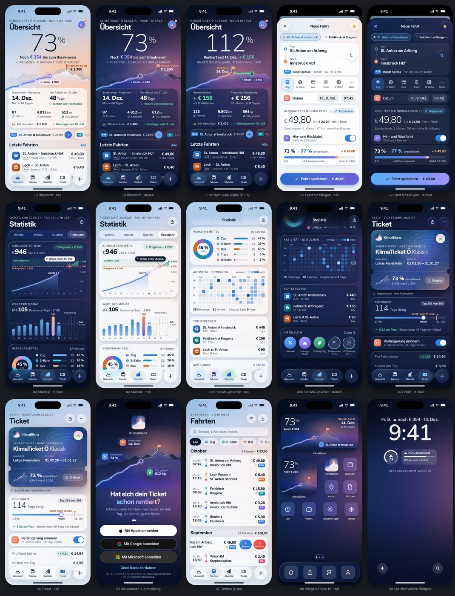

# KlimaBilanz

**Hat sich dein KlimaTicket schon rentiert?** KlimaBilanz ist eine native Premium-iOS-App (SwiftUI, iOS 26, Liquid Glass),
die jede deiner Öffi-Fahrten mit dem regulären Ticketpreis bewertet und dir auf einen Blick zeigt, wie weit dein
Ticket schon „amortisiert“ ist – inklusive Prognose, wann du den Break-even-Gipfel erreichst.

**Design „Alpine Glass“** – Gewinner eines internen Design-Wettbewerbs (3 Richtungen, 3 Juroren): Deine Ersparnis
klettert über ein Arlberg-Panorama zum Gipfel – der Gipfel ist der Ticketpreis, der Break-even der Tag, an dem du die
Fahne hisst. Lebendiger Alpenhimmel (hell „Morgendämmerung“, dunkel „Blaue Stunde“ mit Sternen), Liquid Glass für die
Bedienung, Frost-Karten für Inhalte.

## Funktionen

- **Übersicht** – riesige Amortisations-Anzeige mit „Gipfel“-Grafik, Break-even-Prognose, Kennzahlen, Schnellerfassung
- **Fahrten erfassen in Sekunden** – 39.711 Haltestellen und 21.050 Orte (ÖBB-, Verbund- und Wiener-Linien-Fahrplandaten, OSM) mit
  Offline-Suche, Lieblingsfahrten, „Nochmal fahren“, Hin & Retour, Via-Halte, Mitfahrende, Notizen
- **Fahrplan** – Verbindungen und Abfahrtstafeln mit Echtzeit, Preis und „Deckt dein KlimaTicket die Fahrt?“,
  Zugsuche nach Zugnummer, **Live verfolgen** mit Live Activity, **Zug-Radar** und Karte mit Ebenen, Störungen,
  Haltestellen-Details mit Ausstattung, **Meine Routen** und **Alarme**. Live-Daten gibt es nur mit deiner Einwilligung und bei geöffneter
  App; im Hintergrund fragt die App höchstens für eine Verfolgung nach, für die du Live-Mitteilungen eingeschaltet hast
- **Zug-Radar** – alle Züge Österreichs auf der Apple-Karte, mit höchstens 24 Anfragen je Minute ([docs/OEBB_LIVE.md](docs/OEBB_LIVE.md) §R11).
  Die Ebene **Pünktlichkeit** färbt ein Sechseckraster nach der mittleren Verspätung (eine Momentaufnahme, keine ÖBB-Statistik,
  [docs/RADAR_HEATMAP.md](docs/RADAR_HEATMAP.md)); die **Zeitreise** zeigt, wo die Züge von 30 Minuten zurück bis 3 Stunden voraus sind, berechnet
  aus Fahrplan und den Verspätungen von jetzt, nicht gemessen ([docs/RADAR_TIMETRAVEL.md](docs/RADAR_TIMETRAVEL.md)); die **Cockpit-Ansicht**
  folgt einem Zug schräg in 3D, mit nächstem Halt, Ankunft und Verspätung ([docs/RADAR_COCKPIT.md](docs/RADAR_COCKPIT.md)). Wie die drei
  zusammenspielen: [docs/OEBB_LIVE.md](docs/OEBB_LIVE.md) §R11.3. Nur mit Live-Daten und bei offener App; die drei sind noch nicht auf einem
  iPhone geprüft. **Bus, Bim und U-Bahn** kommen in der Stadt über eine eigene Spur im selben Budget, mit Wegzeichen-Schildern, Legende und
  Zählzeile ([docs/RADAR_MODES.md](docs/RADAR_MODES.md))
- **Exakte Normalpreise** – offizielle ÖBB-Relationspreise (178.013 Relationen zwischen 979 Tarifpunkten, Tarif ab 14.12.2025),
  sonst kalibrierte Schätzung nach Bahnkilometern; Kernzonen-Tarife in Städten; Vorteilscard & 1. Klasse; **Tarifstand** warnt vor Preis- und Fahrplanwechseln
- **KlimaTickets** – KlimaTicket Ö (Klassik/Jugend/Senior/Spezial/Familie, Preise 2021–2026 nach Gültigkeitsbeginn)
  und die regionalen Tickets der Bundesländer (80 Tarifvarianten im Katalog; der Tarifstand zeigt, wie aktuell er ist)
- **Statistik** – Ersparnis-Verlauf mit Prognose, Monatsbilanz, Verkehrsmittel, Wochentage, Reise-Kalender,
  Top-Strecken, Rekorde, „Welches Ticket lohnt sich?“, **Was wäre wenn?**, Öffis vs. Auto, CO₂-Bilanz, Österreich-Karte, Jahresbericht als PDF
- **Zeitbilanz** – deine Stunden in Bahn und Bus, ehrlich getrennt in erfasst (eingetragene Dauer, Abfahrt & Ankunft) und geschätzt
  (Durchschnittstempo), dazu wie lange du mit dem Auto selbst gefahren wärst, erfasste Verspätungen und die letzten 12 Wochen; optionale
  „Dauer“ im Fahrt-Editor ([docs/TIME_BALANCE.md](docs/TIME_BALANCE.md))
- **Dein Jahr** – der Jahresrückblick als Geschichte zum Teilen
- **Digitales Ticket** – Wallet-Karte mit holografischem Schimmer, Gültigkeit, Verlängerungs-Erinnerungen, Ticket-Jahre; Briefe zu
  Fahrgastrechten (Widerspruch, Kündigung) und Ratenübersicht
- **Erfolge** – 17 Abzeichen von „Eingestiegen“ bis „Ganz Österreich“
- **Aussteige-Wecker** – klingelt kurz vor deinem Ausstieg, nach Fahrplan (mit Verspätung) und per Standort (bei gesperrtem iPhone mit der
  Erlaubnis „Immer“); der Standort bleibt auf dem Gerät und wird nicht gespeichert. Noch nicht auf einem iPhone geprüft
  ([docs/EXIT_ALARM.md](docs/EXIT_ALARM.md), mit Geräte-Checkliste und den Grenzen)
- **Anschluss-Wächter** – verfolgst du eine Verbindung mit Umstieg live, zeigt das Blatt der Verfolgung, wie viele Minuten zum Umsteigen
  bleiben (Sicher, Wird knapper, Wackelt, Wahrscheinlich verpasst, Verpasst, Fällt aus), mit Fußweg, Gleis und Trend, und wenn es eng
  wird die nächsten Verbindungen ab dem Umstiegsbahnhof. Dieselbe Zahl wie im Verbindungsdetail; nur bei offener App; noch nicht auf
  einem iPhone geprüft ([docs/CONNECTION_GUARD.md](docs/CONNECTION_GUARD.md))
- **Fahrten erkennen** – „Fahrt aufzeichnen“ (genau, mit Live-Karte und Live Activity) und die optionale **Hintergrund-Erkennung (Beta)**:
  Vorschläge mit ehrlichem Etikett (Vielleicht, Wahrscheinlich, Sicher) in der Übersicht, nie ohne dein Okay erfasst; grobe Standortpunkte
  höchstens 36 Stunden nur auf dem iPhone ([docs/TRIP_DETECTION.md](docs/TRIP_DETECTION.md), mit Geräte-Checkliste und den Grenzen)
- **Pendel-Modus** – deine Stammstrecke (aus deinen Fahrten erkannt, aus „Meine Routen“ oder zwei Stationen): vor der Abfahrt die nächsten
  drei Verbindungen mit Verspätung, Gleis und bei Ausfall der nächsten Verbindung, Erfassen mit einem Tipp, „Wann fährt mein nächster
  Zug?“ per Siri; dazu „Nächste Abfahrten“ im Haltestellen-Detail. Verspätungen nur mit Live-Daten und nur bei offener App; noch nicht auf
  einem iPhone geprüft ([docs/COMMUTE.md](docs/COMMUTE.md))
- **Kalender-Vorschläge** (aus, bis du sie einschaltest) – Termine der nächsten 14 Tage mit Bahnhof oder Stadt im Ort werden in der
  Übersicht zu Zugfahrt-Vorschlägen mit Ankunftszeit und einem Tipp in den Fahrplan; am Tag danach „Warst du gefahren?“. Nur eindeutige
  Bahnhöfe, eine Stadt „ungefähr“ über ihren Hauptbahnhof; gelesen nur auf dem iPhone und bei offener App, Titel und Orte werden nie
  gespeichert; noch nicht auf einem iPhone geprüft ([docs/CALENDAR_SUGGESTIONS.md](docs/CALENDAR_SUGGESTIONS.md))
- **Automatik** – eigene Regeln „Wenn … dann …“ auf dem iPhone: vor Ablauf erinnern, Meilensteine feiern, abends erinnern, wenn noch keine
  Fahrt erfasst ist, Verspätung der verfolgten Fahrt melden, nach einer Fahrt ab einem Wert. Ein Testlauf erklärt jede Entscheidung, ein
  Protokoll zeigt, was passiert ist. Regeln laufen nur bei offener App oder als vorab geplante Mitteilung, schreiben nie Fahrten und fragen
  nichts im Netz ab; noch nicht auf einem iPhone geprüft ([docs/AUTOMATION.md](docs/AUTOMATION.md))
- **Widgets, Sperrbildschirm, StandBy, Kontrollzentrum, Siri & Kurzbefehle** – inkl. interaktiver Schnellerfassung; die Widgets lesen nur
  einen Cache und machen nie einen Netzaufruf. „Gesperrt & privat“ verbirgt Strecken (Standard) und auf Wunsch Beträge am gesperrten
  iPhone; die Widgets melden dem Smart Stack, wann sie gerade wichtig sind (kurz vor der Abfahrt, am Break-even-Tag – die Reihung
  entscheidet iOS); „Unterwegs“ und „Live verfolgen“ haben ein kleines Layout
  für den Smart Stack einer gekoppelten Apple Watch, ohne Watch-App (Sperre und Watch noch nicht auf Geräten geprüft,
  [docs/WIDGETS_SMARTSTACK.md](docs/WIDGETS_SMARTSTACK.md))
- **KI auf dem Gerät** (Apple Intelligence, optional und abschaltbar) – Suche in Alltagssprache, Erklärung der Ticket-Bilanz, Wochenrückblick
- **Konten** – Anmeldung mit Google, Microsoft oder Apple (je nachdem, was dein Backend eingerichtet hat) und Cloud-Sync zwischen Geräten
  über ein eigenes, kostenloses Cloudflare-Backend (Worker + D1, Daten in der EU) – optional, ohne Konto bleibt alles lokal
- **Updates mit einem Tipp** – neue Versionen werden automatisch erkannt (In-App-Hinweis, AltStore/SideStore-Quelle, TestFlight oder App Store) – ein Tipp, und die App ist aktuell; Ticketpreise aktualisieren sich von selbst
- **Funktionen** – jede Funktion mit eigenem Schalter (Zug-Radar, Züge suchen, Störungen, Vorteile-Karte, Gipfelbuch-Vorschau, „Diese
  Woche“ und die bestehenden Schalter an einem Ort); was aus ist, verschwindet und wird dort genannt. Ein **Offline-Modus** stoppt alle
  Live-Daten und die automatische Update-Prüfung, ohne deine Zustimmung zu ändern; der **Datenschutz-Überblick** zeigt, wer was wann
  bekommt und wie viele Live-Anfragen in dieser Sitzung wirklich hinausgingen. Noch nicht auf einem iPhone geprüft
  ([docs/FUNCTIONS_HUB.md](docs/FUNCTIONS_HUB.md))
- **Datenschutz** – ohne Konto bleibt alles auf dem iPhone; kein Tracking, keine Werbung

## Installieren

Jeder Build auf GitHub erzeugt eine `.ipa`-Datei (Actions › iOS › Artifacts, bzw. unter Releases).
Installation per AltStore, SideStore, Sideloadly oder TestFlight – Details in [docs/SETUP.md](docs/SETUP.md).

## Entwicklung

- Architektur: [docs/ARCHITECTURE.md](docs/ARCHITECTURE.md) · Design: [docs/DESIGN.md](docs/DESIGN.md) ·
  Design-System-API: [docs/DESIGN_SYSTEM_API.md](docs/DESIGN_SYSTEM_API.md)
- Projekt erzeugen: `brew install xcodegen && xcodegen generate`
- Kernlogik testen (macOS oder Linux): `swift test --package-path Packages/KlimaCore` und
  `swift test --package-path Packages/KlimaCloud`
- Cloud-Backend (Cloudflare Worker + D1): [docs/CLOUDFLARE_BACKEND.md](docs/CLOUDFLARE_BACKEND.md), Einrichtung in
  [docs/SETUP.md §3](docs/SETUP.md), Tests: `cd backend && npm ci && npm test`
- Tarifkatalog neu bauen: `python3 scripts/build_tariffs.py` · Preistabelle: `python3 scripts/build_relations.py`
- Haltestellen/Orte neu bauen: `sh scripts/fetch_places_sources.sh && python3 -I scripts/build_places.py`
  (siehe [docs/DATA_SOURCES.md](docs/DATA_SOURCES.md), Suche: [docs/PLACES.md](docs/PLACES.md))

## Datenquellen

Ticketpreise: klimaticket.at & Verkehrsverbünde · Normalpreise: ÖBB Relationspreise · Haltestellen (alle ~40.000
österreichischen Haltestellen): Mobilitätsverbünde Österreich (Haltestellenverzeichnis, verändert), ÖBB-Personenverkehr
(GTFS, CC BY 4.0), ÖBB-Infrastruktur (CC BY 3.0 AT), Stadt Wien – data.wien.gv.at (CC BY 4.0), Land Steiermark (CC BY 4.0),
Statistik Austria (CC BY 4.0) · Orte: © OpenStreetMap-Mitwirkende (ODbL) · CO₂: Umweltbundesamt.
Details und Lizenzen: [docs/DATA_SOURCES.md](docs/DATA_SOURCES.md).

KlimaBilanz ist ein unabhängiges Projekt und steht in keiner Verbindung zur One Mobility GmbH oder zur ÖBB.
